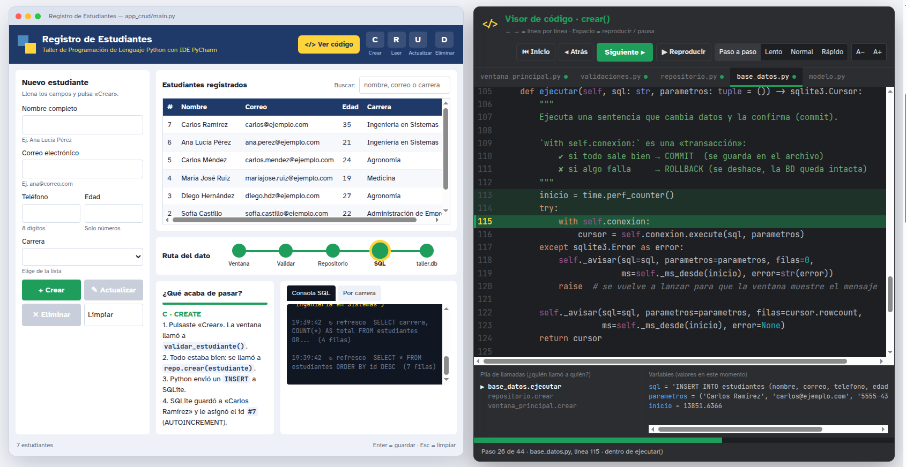

<div align="center">

# Taller de Python con PyCharm

**Construye un sistema CRUD con ventana gráfica y base de datos SQLite, y mira por dentro cada línea que se ejecuta.**

[](https://github.com/JoseMan200124/taller-python-pycharm/actions/workflows/pruebas.yml)


[](LICENSE)

[**▶ Abrir el simulador en el navegador**](https://joseman200124.github.io/taller-python-pycharm/presentacion/) ·
[Instalación](docs/INSTALACION.md) ·
[Guía del instructor](docs/GUIA_INSTRUCTOR.md) ·
[Arquitectura](docs/ARQUITECTURA.md) ·
[Retos](retos/RETOS.md)

<br>



</div>

---

## ¿Qué es?

Un taller completo y listo para dictar que lleva a estudiantes **desde su primera variable hasta un sistema CRUD con interfaz gráfica conectado a una base de datos**, en una sola jornada (4 h, o 2 h 30 min en su versión corta).

Usa únicamente la biblioteca estándar de Python: `tkinter` para la ventana y `sqlite3` para la base de datos. **No hay que instalar ningún paquete.**

Lo que lo distingue es que el programa se explica a sí mismo: cada clic muestra el SQL que se envió, el recorrido del dato por las capas de la aplicación y **la línea de Python que se está ejecutando**, con la pila de llamadas y el valor de las variables en ese instante.

## Contenido del taller

| # | Lección | Temas |
|---|---|---|
| 01 | [`hola_python`](lecciones/01_hola_python.py) | Variables, tipos, f-strings, `input()` |
| 02 | [`decisiones_y_validacion`](lecciones/02_decisiones_y_validacion.py) | `if`, `while`, `try/except`, primer uso del depurador |
| 03 | [`crud_en_memoria`](lecciones/03_crud_en_memoria.py) | Listas, diccionarios, menú CRUD |
| 04 | [`sqlite_primeros_pasos`](lecciones/04_sqlite_primeros_pasos.py) | `INSERT`, `SELECT`, `UPDATE`, `DELETE` |
| 05 | [`crud_consola_sqlite`](lecciones/05_crud_consola_sqlite.py) | Funciones, transacciones, demostración de inyección SQL |
| 06 | [`primera_ventana`](lecciones/06_primera_ventana.py) | `tkinter`: eventos, widgets, `grid` |
| 07 | [`crud_grafico_un_archivo`](lecciones/07_crud_grafico_un_archivo.py) | Ventana + SQLite en un solo archivo |
| 🏁 | [`app_crud/`](app_crud/) | El mismo sistema, ordenado en capas |

Los estudiantes construyen el mismo sistema tres veces, cada vez más completo: **en memoria**, **con SQLite en consola** y **con ventana**. Al final recorren juntos la versión profesional en `app_crud/`.

## Inicio rápido

```bash
git clone https://github.com/JoseMan200124/taller-python-pycharm.git
cd taller-python-pycharm

python verificar_entorno.py      # ¿la computadora está lista?
python app_crud/main.py          # abre la aplicación final
```

> En Linux, si falta `tkinter`: `sudo apt install python3-tk`. Para el paso a paso con PyCharm, consulta [`docs/INSTALACION.md`](docs/INSTALACION.md).

## La aplicación final

`app_crud/main.py` abre un registro de estudiantes en el que cada acción se explica sola:

- **Semáforo C R U D**: la letra de la operación se enciende en el encabezado.
- **Ruta del dato**: el dato recorre Ventana → Validar → Repositorio → SQL → `taller.db` y se detiene con una ✕ donde falló.
- **¿Qué acaba de pasar?**: una pizarra que lo explica en español sencillo.
- **Consola SQL en vivo**: el SQL exacto de cada clic, con los `?` y los valores por separado.
- **Gráfico por carrera**: barras animadas dibujadas a mano con `Canvas`.
- **Visor de código** (`F2`): una ventana tipo PyCharm donde brilla la línea que se ejecuta, archivo por archivo. No es una simulación: cada botón se graba en vivo con `sys.settrace`, el mismo mecanismo que usan los depuradores, y luego se reproduce despacio.

## El simulador web

[`presentacion/index.html`](presentacion/index.html) reproduce la aplicación y su visor de código **en el navegador**, sin instalar nada. Está pensado para proyectar en clase:

| Control | Acción |
|---|---|
| `Siguiente ▸` · <kbd>→</kbd> | Avanza una línea |
| `◂ Atrás` · <kbd>←</kbd> | Regresa una línea |
| `⏮ Inicio` | Vuelve a la primera línea del recorrido |
| Barra de progreso | Clic para saltar a cualquier punto |
| `▶ Reproducir` · <kbd>Espacio</kbd> | Avanza solo (Lento, Normal o Rápido) |
| `A−` · `A+` | Tamaño de letra para el proyector |

Por defecto arranca en **Paso a paso**: tras cada clic en la aplicación, el visor espera a que el instructor avance. El código que se muestra es el de `app_crud/`, insertado en la página por [`presentacion/construir.py`](presentacion/construir.py). Si cambias la aplicación, vuelve a generarla:

```bash
python presentacion/construir.py
```

Disponible en línea en **<https://joseman200124.github.io/taller-python-pycharm/presentacion/>**.

## Estructura del repositorio

```
taller-python-pycharm/
├── verificar_entorno.py     comprueba Python ≥ 3.10 y tkinter
├── lecciones/               siete lecciones progresivas, un archivo por tema
├── app_crud/                aplicación final, organizada en capas
│   ├── main.py              punto de entrada
│   ├── modelo.py            qué es un Estudiante (dataclass)
│   ├── validaciones.py      reglas de los datos de entrada
│   ├── repositorio.py       operaciones CRUD
│   ├── base_datos.py        única puerta de entrada a SQLite
│   ├── configuracion.py     colores, carreras y ajustes
│   └── interfaz/            ventana, formulario, tabla, visor de código…
├── presentacion/            simulador web (plantilla, motor y generador)
├── tests/                   pruebas automáticas del CRUD
├── retos/RETOS.md           ejercicios por nivel, con pistas
└── docs/                    instalación, guía del instructor y arquitectura
```

El diseño por capas, el flujo de cada operación y el funcionamiento del visor se explican en [`docs/ARQUITECTURA.md`](docs/ARQUITECTURA.md).

## Pruebas

```bash
python -m unittest discover -s tests -v
```

Las pruebas usan una base de datos en memoria y no abren ventanas, así que corren en cualquier entorno, incluida la integración continua de GitHub Actions (Python 3.10 a 3.13).

## Para instructores

[`docs/GUIA_INSTRUCTOR.md`](docs/GUIA_INSTRUCTOR.md) incluye la agenda minuto a minuto (4 h y 2 h 30 min), los momentos clave de cada bloque, cómo usar el visor de código y una lista de verificación para el día del taller. Los [retos](retos/RETOS.md) están organizados en tres niveles para trabajar en parejas.

## Contribuir

Las mejoras son bienvenidas: correcciones, nuevos retos, traducciones o ideas para explicar mejor. Revisa [`CONTRIBUTING.md`](CONTRIBUTING.md) antes de abrir un *pull request*.

## Licencia

Publicado bajo la [licencia MIT](LICENSE). Puedes usar, adaptar y dictar este taller libremente, incluso con fines comerciales, conservando el aviso de licencia.
