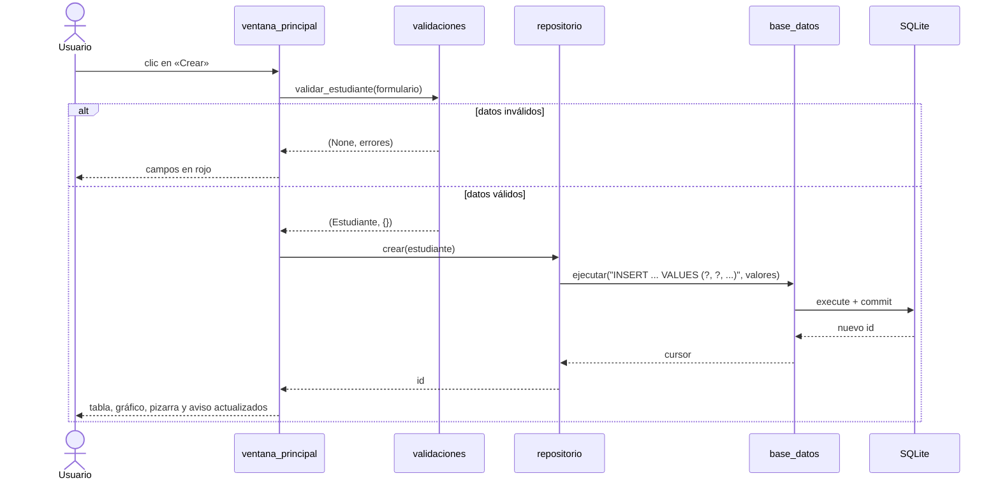

# Arquitectura

Este documento explica cómo está organizada la aplicación final (`app_crud/`) y cómo funcionan sus dos herramientas didácticas: el **visor de código** de escritorio y el **simulador web**.

## Capas

La aplicación separa responsabilidades en capas. Cada una solo conoce a la de abajo, y **solo `base_datos.py` habla con SQLite**.


| Módulo | Responsabilidad |
|---|---|
| `main.py` | Punto de entrada: crea la base de datos y abre la ventana. |
| `modelo.py` | `Estudiante`, una `dataclass` que solo transporta datos. |
| `validaciones.py` | `validar_estudiante(datos)` → `(estudiante, errores)`. Nunca toca la base de datos. |
| `repositorio.py` | `RepositorioEstudiantes`: `crear`, `listar`, `obtener`, `actualizar`, `eliminar`, `contar_por_carrera`. Traduce objetos a SQL parametrizado. |
| `base_datos.py` | `BaseDatos`: conexión, `ejecutar` (con *commit* o *rollback* automático) y `consultar`. Avisa a sus «oyentes» de cada sentencia, y así existe la Consola SQL. |
| `configuracion.py` | Colores, carreras, textos y ajustes en un solo lugar. |
| `datos_ejemplo.py` | Siembra estudiantes ficticios para que la tabla no arranque vacía. |
| `interfaz/` | Todo lo visible: ventana, formulario, tabla, pizarra, ruta del dato, consola SQL, gráfico, animaciones y visor. |

Si mañana se cambia SQLite por PostgreSQL, solo se toca `base_datos.py`. Esa es la lección de fondo del diseño por capas.

## ¿Por qué está dividido así?

### El problema que resuelve

La lección 07 hace el mismo CRUD en un solo archivo de unas 200 líneas, y funciona. Pero tiene tres problemas que aparecen en cuanto el sistema crece:

1. **Un cambio toca todo.** Para cambiar SQLite por MySQL hay que buscar SQL mezclado entre botones.
2. **No se puede probar sin abrir la ventana.** Para comprobar que `crear()` funciona hay que hacer clic a mano.
3. **No se puede trabajar en equipo.** Dos personas en el mismo archivo chocan.

`app_crud/` es el mismo sistema, pero además **se puede cambiar, probar y repartir**.

### Una analogía: un restaurante

| Restaurante | Archivo | Qué hace |
|---|---|---|
| El mesero | `ventana_principal.py` | Atiende al cliente y lleva pedidos. **No cocina.** |
| El que revisa la orden | `validaciones.py` | «¿Ese platillo existe? ¿Falta algo?» |
| El cocinero | `repositorio.py` | Sabe preparar cada platillo: crear, listar, actualizar, eliminar. |
| La bodega | `base_datos.py` | La única puerta a los ingredientes (SQLite). |
| La comanda | `modelo.py` | El papel con el pedido que pasa de mano en mano: el `Estudiante`. |

Si el mesero entrara a la bodega a sacar ingredientes, sería un desorden. Eso es la lección 07.

### Cada pieza ya apareció en una lección

| Archivo | Lección donde se vio | Qué cambia aquí |
|---|---|---|
| `modelo.py` | 03 (diccionario = ficha) | El diccionario pasa a ser una `dataclass`. |
| `validaciones.py` | 02 (`if`, `try/except`) | Las mismas validaciones, juntas en una función. |
| `base_datos.py` | 04 (conectar, `CREATE TABLE`) | La conexión vive en una clase: la única puerta a SQLite. |
| `repositorio.py` | 05 (`crear()`, `listar()`…) | Las mismas cuatro funciones, dentro de una clase. |
| `ventana_principal.py` | 06 y 07 (botones, `command=`) | La ventana ya no sabe SQL: le pide todo al repositorio. |

Estos cinco archivos son los que muestra el visor de código, porque son los únicos por los que pasa el dato. Los demás (`configuracion.py`, `datos_ejemplo.py` y casi todo `interfaz/`) son apariencia y ayudas didácticas.

### Buenas prácticas aplicadas

| # | Práctica | Dónde se ve |
|---|---|---|
| 1 | **Separación de responsabilidades**: cada archivo tiene un solo trabajo. | Busca `INSERT` en `ventana_principal.py`: no hay ninguno. |
| 2 | **Arquitectura por capas**: cada capa solo llama a la de abajo. | `Ventana → Repositorio → BaseDatos → taller.db`; el visor siempre recorre las pestañas en ese orden. |
| 3 | **Patrón Repositorio**: todo el CRUD de una tabla en una clase. | `repo.crear(estudiante)`: quien lo llama no ve el SQL. |
| 4 | **Un solo punto de acceso a la base de datos**. | Todo SQL pasa por `BaseDatos.ejecutar()` o `consultar()`; por eso la Consola SQL se agregó sin tocar nada más. |
| 5 | **Modelo de datos explícito**. | `estudiante.correo` en vez de `fila[2]`; `Estudiante.desde_fila()` traduce en un solo lugar. |
| 6 | **Defensa en profundidad**: se valida dos veces. | Python valida primero, con mensajes amables (`validaciones.py`); SQLite valida al final con `UNIQUE`, `CHECK` y `NOT NULL`. |
| 7 | **Consultas parametrizadas** (`?`) siempre. | Todo `repositorio.py`; `test_inyeccion_sql_no_funciona` lo comprueba. |
| 8 | **Transacciones**. | `with self.conexion:` en `ejecutar()`: COMMIT si todo sale bien, ROLLBACK si algo falla. |
| 9 | **Los errores se relanzan, no se esconden**. | `base_datos.py` avisa y hace `raise`; la ventana es la que se lo explica al usuario. |
| 10 | **Inyección de dependencias**: las piezas se conectan en un solo lugar. | `main.py` crea `BaseDatos`, se la pasa al repositorio y los dos a la ventana. Las pruebas usan `BaseDatos(":memory:")`. |
| 11 | **Pruebas automáticas**. | `tests/test_crud.py`. Solo es posible porque el CRUD no depende de la ventana. |
| 12 | **Configuración centralizada**. | Colores, rutas y carreras en `configuracion.py`. |
| 13 | **Legibilidad**. | Type hints (`-> int`), docstrings, una cabecera con diagrama en cada archivo y avisos como `# ⚠️ sin WHERE se borra TODO`. |

**Regla para recordar:** cada archivo tiene un solo trabajo. La ventana no sabe SQL y el repositorio no sabe de botones.

> Para un CRUD de una sola tabla, esta estructura es más de lo estrictamente necesario. Se hizo así a propósito: enseña cómo se organiza un sistema que va a crecer.

## Recorrido de una operación

Así viaja el dato cuando el usuario pulsa **Crear**:



Si SQLite rechaza la operación (por ejemplo, un correo repetido que viola `UNIQUE`), `base_datos.py` hace *rollback* y relanza la excepción. Esta sube por el repositorio hasta la ventana, que la explica al usuario.

**Seguridad:** todas las consultas usan parámetros `?`. La lección 05 y el simulador web muestran, lado a lado, por qué concatenar texto en el SQL permite una inyección.

## Visor de código (aplicación de escritorio)

El visor muestra la línea de Python que se ejecuta **de verdad**: no la simula.

1. Los métodos de la ventana que responden a un clic llevan el decorador `@mostrar_en_visor` (`interfaz/rastreador.py`).
2. Al ejecutarse, el decorador instala un espía con `sys.settrace`, el mismo mecanismo que usan los depuradores. Durante esa llamada, el intérprete avisa de cada evento `call`, `line`, `return` y `exception`.
3. El `Rastreador` anota un `Paso` por línea (archivo, número, función, pila y variables locales) solo para los archivos visibles: `ventana_principal.py`, `validaciones.py`, `repositorio.py`, `base_datos.py` y `modelo.py`.
4. Al terminar retira el espía, y `interfaz/visor_codigo.py` reproduce la lista con la línea resaltada, la pila de llamadas y las variables que cambiaron.

Si el depurador de PyCharm está activo, `sys.settrace` ya está ocupado y el visor no graba, para no interferir.

## Simulador web (`presentacion/`)

El simulador replica la aplicación y su visor en una sola página HTML, sin servidor y sin instalar Python.

| Archivo | Papel |
|---|---|
| `plantilla.html` | Interfaz, estilos y reproductor del visor. |
| `motor.js` | Versiones en JavaScript de las funciones de `app_crud/`. Cada una llama a `P('texto de la línea')`, que localiza esa línea en el **código Python real** y la registra como paso. |
| `grabar_lecciones.py` | Ejecuta los ejemplos de `lecciones/ejemplos/` y graba cada paso en `lecciones.json` (ver abajo). |
| `construir.py` | Inserta los `.py` de `app_crud/`, la grabación de las lecciones y el motor en la plantilla, y escribe `index.html`. |

Como el visor busca cada línea por su texto, el código que se muestra siempre es el de `app_crud/`. Si se edita la aplicación:

```bash
python presentacion/construir.py
```

Si alguna línea que el motor espera ya no existe, aparece en `Motor.faltantes` (consola del navegador) para actualizar `motor.js`.

### Las lecciones, paso a paso

La primera sección de la página no usa un motor en JavaScript: muestra una **grabación real**. `grabar_lecciones.py` ejecuta cada ejemplo con Python bajo `sys.settrace` y, antes de cada línea, guarda:

- el número de línea, la función y la pila de llamadas;
- las variables (locales y globales) con un `repr` corto;
- cuánto lleva impreso la consola (`print`), con las respuestas de `input()` marcadas;
- la tabla `estudiantes` de la conexión SQLite que tenga el ejemplo, si existe;
- en los ejemplos con ventana, el estado de cada widget.

Las respuestas a `input()` vienen de la lista `entradas` de cada lección. Los ejemplos 06 y 07 se graban con un `tkinter` mínimo que imita al real (`Tk`, `StringVar`, `IntVar`, `Label`, `Entry`, `Button`, `Listbox`). Su `mainloop()` no espera clics: reproduce los `eventos` configurados («escribe Ana», «clic en Crear»). En PyCharm los mismos archivos abren la ventana de verdad.

La grabación se guarda en `lecciones.json` y se versiona junto con el código. Así `construir.py` siempre produce la misma página, sin importar la versión de Python que lo ejecute. Si cambias un ejemplo:

```bash
python presentacion/grabar_lecciones.py
python presentacion/construir.py
```

## Pruebas

`tests/test_crud.py` prueba el modelo, las validaciones y el repositorio contra una base SQLite en memoria (`:memory:`), sin abrir ventanas. `tests/test_lecciones.py` comprueba que cada ejemplo de `lecciones/ejemplos/` se graba completo. Ninguna abre ventanas, así que corren en cualquier máquina y en la integración continua.
