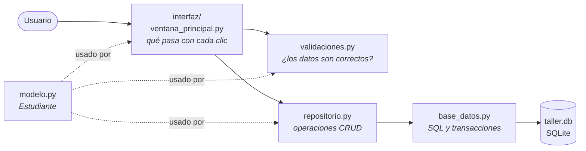
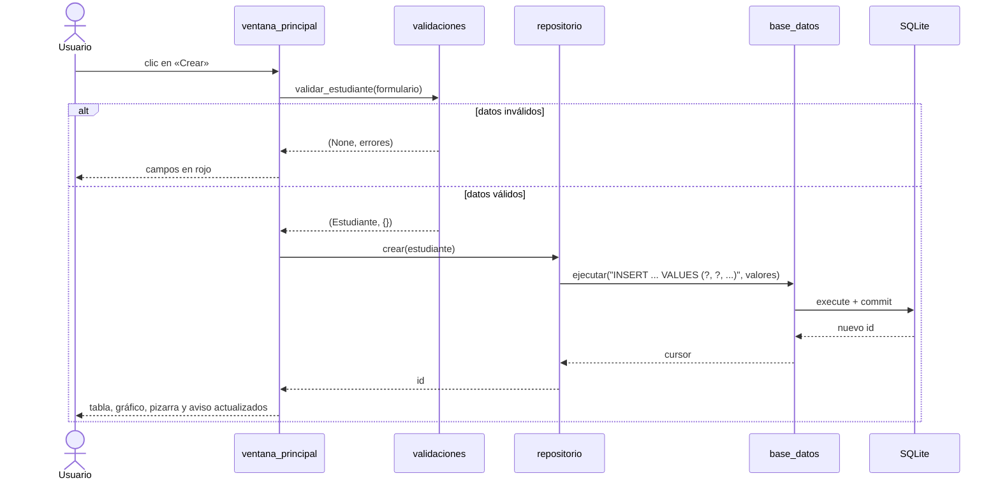

# Arquitectura

Este documento explica cómo está organizada la aplicación final (`app_crud/`) y cómo funcionan sus dos herramientas didácticas: el **visor de código** de escritorio y el **simulador web**.

## Capas

La aplicación separa responsabilidades en capas. Cada una solo conoce a la de abajo, y **solo `base_datos.py` habla con SQLite**.



| Módulo | Responsabilidad |
|---|---|
| `main.py` | Punto de entrada: crea la base de datos y abre la ventana. |
| `modelo.py` | `Estudiante`, una `dataclass` que solo transporta datos. |
| `validaciones.py` | `validar_estudiante(datos)` → `(estudiante, errores)`. Nunca toca la base de datos. |
| `repositorio.py` | `RepositorioEstudiantes`: `crear`, `listar`, `obtener`, `actualizar`, `eliminar`, `contar_por_carrera`. Traduce objetos a SQL parametrizado. |
| `base_datos.py` | `BaseDatos`: conexión, `ejecutar` (con *commit* o *rollback* automático) y `consultar`. Avisa a sus «oyentes» de cada sentencia, y así existe la Consola SQL. |
| `configuracion.py` | Colores, carreras, textos y ajustes en un solo lugar. |
| `datos_ejemplo.py` | Siembra estudiantes ficticios para que la tabla no arranque vacía. |
| `interfaz/` | Todo lo visible: ventana, formulario, tabla, pizarra, ruta del dato, consola SQL, gráfico, animaciones y visor. |

Si mañana se cambia SQLite por PostgreSQL, solo se toca `base_datos.py`. Esa es la lección de fondo del diseño por capas.

## Recorrido de una operación

Así viaja el dato cuando el usuario pulsa **Crear**:



Si SQLite rechaza la operación (por ejemplo, un correo repetido que viola `UNIQUE`), `base_datos.py` hace *rollback* y relanza la excepción. Esta sube por el repositorio hasta la ventana, que la explica al usuario.

**Seguridad:** todas las consultas usan parámetros `?`. La lección 05 y el simulador web muestran, lado a lado, por qué concatenar texto en el SQL permite una inyección.

## Visor de código (aplicación de escritorio)

El visor muestra la línea de Python que se ejecuta **de verdad**: no la simula.

1. Los métodos de la ventana que responden a un clic llevan el decorador `@mostrar_en_visor` (`interfaz/rastreador.py`).
2. Al ejecutarse, el decorador instala un espía con `sys.settrace`, el mismo mecanismo que usan los depuradores. Durante esa llamada, el intérprete avisa de cada evento `call`, `line`, `return` y `exception`.
3. El `Rastreador` anota un `Paso` por línea (archivo, número, función, pila y variables locales) solo para los archivos visibles: `ventana_principal.py`, `validaciones.py`, `repositorio.py`, `base_datos.py` y `modelo.py`.
4. Al terminar retira el espía, y `interfaz/visor_codigo.py` reproduce la lista con la línea resaltada, la pila de llamadas y las variables que cambiaron.

Si el depurador de PyCharm está activo, `sys.settrace` ya está ocupado y el visor no graba, para no interferir.

## Simulador web (`presentacion/`)

El simulador replica la aplicación y su visor en una sola página HTML, sin servidor y sin instalar Python.

| Archivo | Papel |
|---|---|
| `plantilla.html` | Interfaz, estilos y reproductor del visor. |
| `motor.js` | Versiones en JavaScript de las funciones de `app_crud/`. Cada una llama a `P('texto de la línea')`, que localiza esa línea en el **código Python real** y la registra como paso. |
| `construir.py` | Inserta los `.py` de `app_crud/` como JSON y el motor en la plantilla, y escribe `index.html`. |

Como el visor busca cada línea por su texto, el código que se muestra siempre es el de `app_crud/`. Si se edita la aplicación:

```bash
python presentacion/construir.py
```

Si alguna línea que el motor espera ya no existe, aparece en `Motor.faltantes` (consola del navegador) para actualizar `motor.js`.

## Pruebas

`tests/test_crud.py` prueba el modelo, las validaciones y el repositorio contra una base SQLite en memoria (`:memory:`), sin abrir ventanas. Por eso corren en cualquier máquina y en la integración continua.
